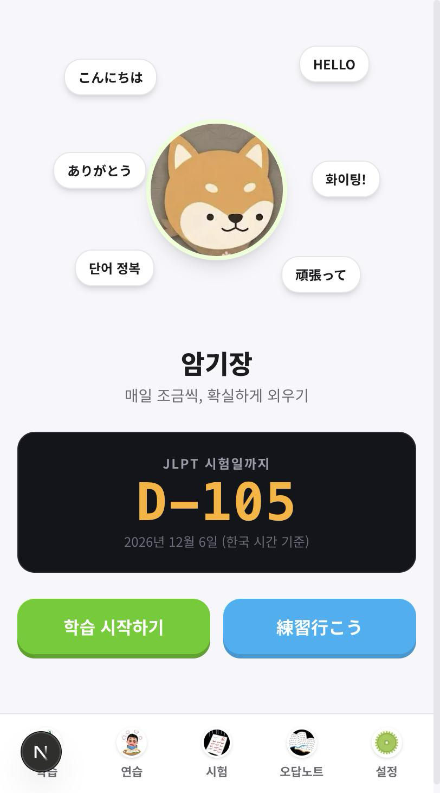
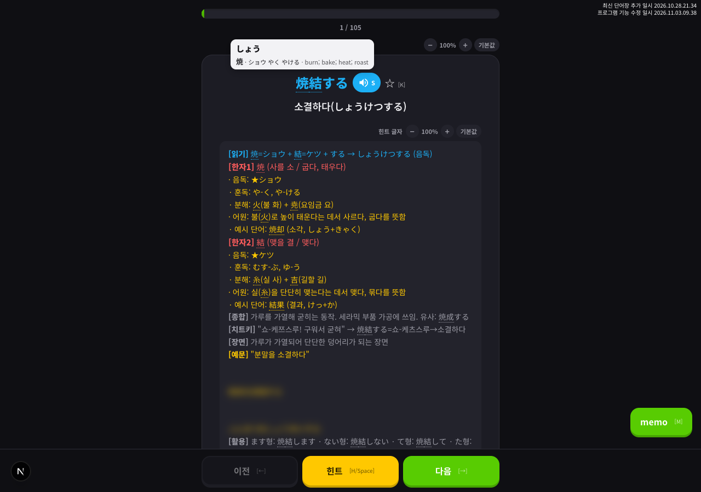
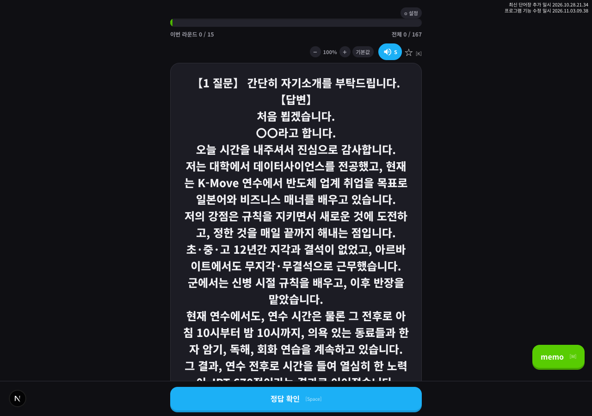
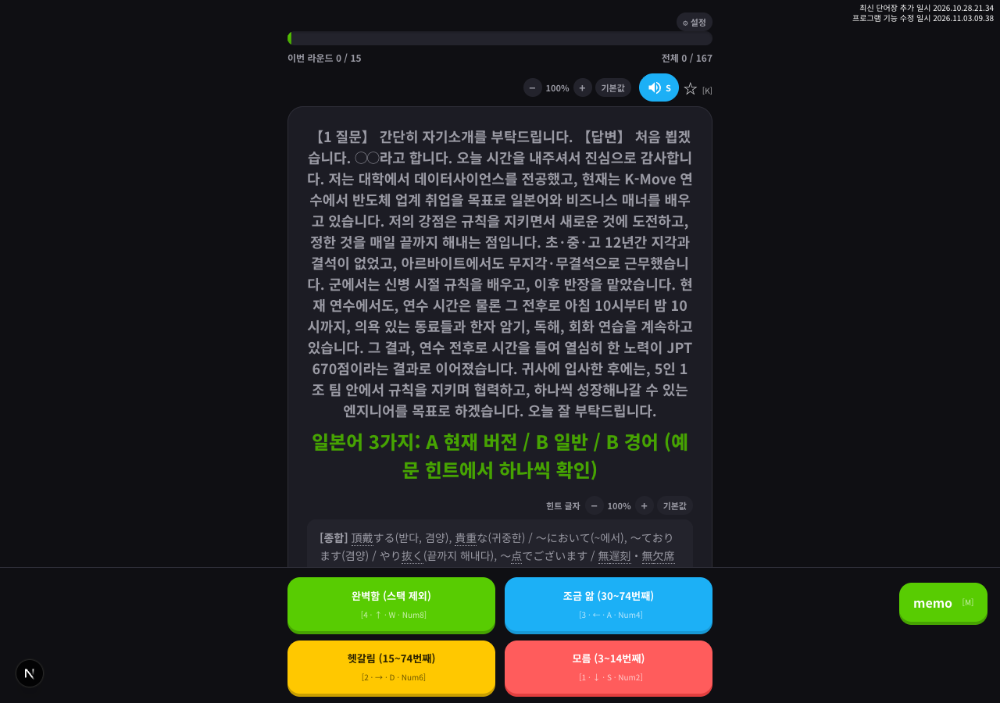
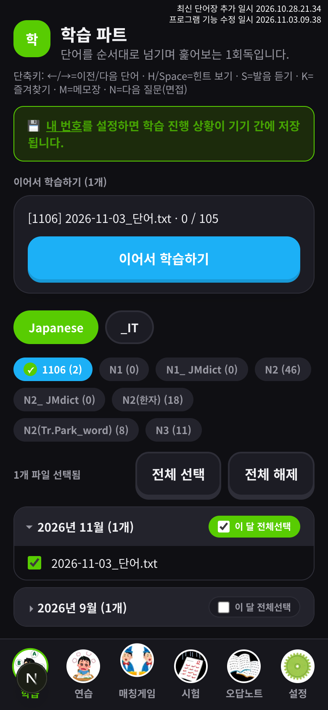

# 단어장 / 単語帳アプリ (word_app)

바로 사용해보기 / 今すぐ試す: [https://wordapp-puce.vercel.app](https://wordapp-puce.vercel.app)

Next.js + Supabase 기반 PWA 단어장 앱입니다. 이 README는 앱을 어떻게 개선해 왔는지만 정리합니다.
(Streamlit 프로토타입 [`word_test`](https://github.com/YSHHAN36565362/word_test)의 후속 버전)
위쪽은 한국어, 아래쪽은 같은 내용의 일본어입니다。

---

## 한국어

### 날짜별 개선 내역

- **2026-11-11 ~ 11-12** — 단어 팝업 확장. ① 한자 팝업에 **읽기별 예시 단어** 추가: 한자의 음독·훈독마다 그 읽기로 읽히는 흔한 단어를 하나씩 보여줍니다(예: 暴 → ボウ 暴力 · バク 暴露 · あばく 暴く · あばれる 暴れる). ② **한자 없이 쓰인 단어도 팝업**: 부사(ますます)·접속사(しかし)·동사·형용사·명사·가타카나어를 누르면 기본형, 한자 표기(益々), 한국어·영어 뜻이 뜹니다. ③ **팝업 종류별 켜기/끄기**: 학습 화면의 "⚙ 팝업", 연습 화면의 "⚙ 설정"에서 한자/부사/접속사/동사/형용사/명사/가타카나를 골라 끌 수 있습니다. ④ 예시가 많아 팝업이 길어지면 팝업 안에서 스크롤되고, 휴대폰 화면 밖으로 잘리지 않습니다. ⑤ N2 한자 단어장 1,753개를 "단어(종합·치트키·장면·예문)" + "문장(단어당 예문 5개)" 형식으로 새로 정리했습니다.
- **2026-11-03** — 연습 모드에서 정답·힌트를 보기 전에는 한자 위 후리가나가 미리 보이지 않도록 변경. 힌트·예문의 한자에 마우스를 올리거나 탭하면 후리가나와 함께 한자 정보(한국 음, 일본 음독·훈독, 영어 뜻) 툴팁 표시. 힌트 글자 크기만 조절하는 버튼, 단어장 공유 링크(`?files=…&mode=…&order=seq` — 열면 상대도 같은 단어장에서 시작), 연습 모드 "순서대로 연습" 옵션 추가. 모바일에서 블러/툴팁 터치 충돌과 툴팁이 화면을 넘어가는 문제 수정.
- **2026-11-02** — 힌트를 단락별 클릭으로 블러 켜기/끄기, 답변을 문장마다 줄바꿈, 박스를 마우스로 크기 조절. 모든 파트에서 학습 진행 과정을 선택해서 삭제. 즐겨찾기 `K` 단축키, 모든 버튼에 단축키 표시(예: `[K]`), `memo`는 `M`. 복습 화면의 "복습 완료"로 복습 목록에서 제거.
- **2026-10-29 ~ 10-30** — 단어장 추가·수정(화면 오른쪽 위에 최신 단어장 추가 일시와 프로그램 기능 수정 일시 표시), UI 다듬기.
- **2026-09-27 / 10-20** — 키보드 단축키 조정, 파일 선택(FileSelector)과 파서 개선, `word_list`를 파일시스템으로 읽도록 변경.
- **2026-09-07 ~ 09-10** — 라운드 출제 로직 개선, 여러 기기에서 진행 상황 공유("내 번호"), 효과음 추가, 설명 정리.
- **2026-08-30 ~ 09-04** — 학습 로그 화면, 애니메이션, 아이콘·UI 다듬기.
- **2026-08-24** — 연습 채점에 방향키/WASD/숫자패드 단축키, "조금 앎(60)"도 완료로 집계, 숙련 단어 복습, 진행 저장 경쟁 상태 수정, 듀오링고식 피드백 효과.
- **2026-08-23** — Next.js + Supabase로 `word_app` 첫 공개. 하단 고정 버튼, 키보드 단축키, 카테고리 순서, 월별 일괄 선택, 플립 카드 표시 수정.

| 한자 툴팁 | 연습 모드 (순서대로 · 공유 링크) |
|---|---|
|  |  |

| 연습 모드 정답 확인 | 모바일(학습 선택) |
|---|---|
|  |  |

### 주제별 개선 내역

#### 연습 큐 / 복습

- **자기 평가를 4단계로 세분화** — 맞음/틀림 2지선다 대신 완벽함(100)·조금 앎(60)·헷갈림(40)·모름(0)으로 나누고, 단계마다 큐에 다시 꽂는 위치를 다르게 했습니다. 완벽함만 즉시 완료 처리하고 나머지 세 단계는 모두 재등장시켜, "한 번 더 확인하고 싶다"는 의견과 "진행률이 안 오른다"는 의견 사이의 균형을 잡았습니다.
- **재삽입 위치를 구간에서 무작위로** — 고정 위치면 단어가 아니라 순서를 외우게 되므로 구간 안에서 무작위로 뽑고, 라운드 크기 기준으로 계산하며, 방금 본 단어가 바로 다음 카드로 나오지 않도록 최소 3장 간격(`MIN_GAP`)을 보장합니다. 채점 버튼의 "N~M번째" 표시도 같은 함수에서 가져와 실제 동작과 항상 일치합니다.
- **숙련도를 세션 밖으로 영구 저장** — 예전에는 큐가 세션 안에서만 동작해 브라우저를 닫으면 채점 결과가 사라졌습니다. 이제 단어별 최신 점수를 Supabase(`word_mastery`)에 저장하고, 다음 연습·시험에서 점수가 낮은 단어가 먼저 나옵니다.
- **복습 화면** — 완벽함/조금 앎으로 끝낸 단어만 모아 다시 연습할 수 있고, 다시 헷갈리는 단어는 개별로 "초기화"해 우선 출제로 되돌릴 수 있습니다. "복습 완료"로 목록에서 제거도 가능합니다.
- **간격 반복(SRS) 단순화** — 맞힐 때마다 간격이 늘어나던 방식(SuperMemo-2)이 4단계 채점과 맞지 않아, 완벽함은 7일 후·조금 앎은 3일 후라는 점수별 고정 간격으로 바꿨습니다. 복습일이 안 된 단어는 그날 연습에서 제외되고, 기한이 된 단어는 "오늘의 복습"에 모입니다.
- **라운드 단위 마이크로 러닝** — 연습을 라운드(기본 15개, 5~50개 조절 가능)로 쪼개 라운드마다 완료 화면을 보여주고, 진행률 바도 라운드 기준으로 채워집니다. 세 번 이상 헷갈림·모름이면 "자주 틀리는 단어" 배지를 붙입니다.
- **채점 되돌리기** — 잘못 누른 점수를 "되돌리기"(Backspace)로 취소합니다. 화면의 큐·진행률뿐 아니라 서버에 저장된 숙련도(SRS 간격 포함)도 채점 전 값으로 되돌립니다.
- **세션 요약 화면** — 끝났을 때 한 줄 안내 대신 단계별 채점 횟수, 총 횟수, 소요 시간, 완벽+조금 앎 비율을 보여줍니다.

#### 진행 상황 저장 / 이어하기

- **학습 대시보드와 "이 학습 다시 하기"** — 파일 조합별 진행률(`42% (99 / 236개 완료, 137개 남음)`)과 이전 조합 드롭다운을 제공하고, 선택하면 파일·모드·큐 위치가 그대로 복원됩니다.
- **기기별 기록 분리** — 같은 번호를 여러 기기에서 쓸 때 나중에 저장한 기기가 이전 기록을 조용히 덮어쓰던 문제를 고쳤습니다. 기기마다 별도 기록을 남기되 번호만 같으면 어느 기기에서든 이어받습니다. 기기에 이름을 붙일 수 있고, 삭제는 기기별로 하나씩만 되어 다른 기기 기록이 실수로 지워지지 않습니다.
- **오프라인/네트워크 단절 대응** — 진행 큐(`progress`)와 요약(`learning_log`)을 저장할 때마다 이 기기의 localStorage에도 즉시 사본을 남겨, 네트워크가 끊기거나 Supabase가 미설정이어도 같은 기기에서는 이어하기가 동작합니다.
- **저장 순서 꼬임 수정** — 단어를 빠르게 넘길 때 늦게 도착한 오래된 응답이 최신 진행 상황을 덮어쓰던 버그를, `progress`·`wrong_notes` 쓰기를 (사용자, 파트)별 큐로 직렬화해 해결했습니다.
- **학습 기록 관리** — 설정에서 학습/연습/시험/지문 기록을 목록으로 보고 개별 삭제할 수 있고(연습 파트는 "이어서 연습하기" 카드와 함께 정리), 목록 로딩 실패 시 "다시 시도" 버튼이 뜹니다.

#### 한자 학습

- **한자 팝업** — 문장 속 한자 단어에 마우스를 올리거나 탭하면 히라가나 읽기와 한자별 정보(한국 한자음 · 일본 음독/훈독 · 영어 뜻)가 뜹니다. 정답·힌트를 보기 전에는 읽기가 미리 보이지 않습니다.
- **읽기별 예시 단어** — 한자의 읽기 하나당 단어 하나를 붙입니다. 단어 안에서 그 한자가 실제로 어떤 읽기로 읽혔는지를 함께 쓰인 한자의 읽기·송리가나까지 대조해 판별하고, 흔히 쓰는 단어를 우선합니다. 맞는 단어가 없는 드문 읽기는 비워 둡니다.
- **가나 단어 팝업** — 한자 없이 쓰인 부사·접속사·동사·형용사·명사·가타카나어도 뜻을 보여줍니다. 활용형은 기본형으로 찾고(できれば → できる), 단어장에 실린 단어는 한국어 뜻을 함께 보여줍니다.
- **종류별 켜기/끄기** — 필요한 종류만 남기도록 학습·연습 진행 중 설정에서 바로 바꿀 수 있고, 기기에 저장됩니다.
- **데이터는 미리 받아 저장** — 예시 단어와 뜻은 빌드용 스크립트가 한 번 받아 `src/data/`에 JSON으로 저장합니다. 학습 중에는 외부 서버를 부르지 않아 빠르고, 외부 서비스가 멈춰도 동작합니다.
- **한자 힌트 구간 설정** — 한자 분해(음독/훈독/어원) 힌트는 구간별로 색·크기를 바꾸거나 숨길 수 있고, 연습 화면에서 "한자 크기"를 바로 조절할 수 있습니다.

#### IT 학습

- **자격증 단어장** — `word_list/_IT/`에 정보처리기사 실기(이론 정리·족보·두음 암기), 빅데이터분석기사 필기(1~4단원) 단어장이 있어, 일본어와 같은 학습·연습·시험·복습 흐름으로 외울 수 있습니다.
- **용어와 설명을 카드로** — 용어를 앞면, 정의·암기 요령을 뒷면/힌트로 두고, 4단계 자기 평가와 간격 반복으로 약한 용어가 먼저 나옵니다.
- **순서대로 연습 · 공유 링크** — 단원 순서 그대로 외우는 "순서대로 연습"과, 같은 단어장에서 바로 시작하는 공유 링크를 지원합니다.

#### 단어장 데이터

- **저장소 자체를 데이터 계층으로** — 읽기는 `word_list/` 폴더를 서버가 파일시스템에서 직접 읽어 GitHub API 호출과 요청 한도를 없앴고, 추가만 서버가 GitHub Contents API로 커밋합니다(토큰이 브라우저에 노출되지 않음).
- **진행 저장을 GitHub 커밋에서 Supabase로** — 단어를 넘길 때마다 커밋하던 방식을 바꿔 더 빠르고 커밋 히스토리도 깨끗해졌습니다.
- **파서 개선** — 콜론 구분/줄 구분 두 형식을 자동 판별하고, 전각 콜론을 정규화하며, (단어, 뜻, 힌트)가 모두 같은 항목은 자동 중복 제거합니다.

#### 추가한 기능

- **연속 학습일(스트릭)**, **즐겨찾기(별표) 단어**, **매칭 게임**(최고 기록 저장), **발음 듣기**(`S`), **손글씨 메모장(memo)**(애플펜슬만 입력, 손바닥 터치 무시), **오늘의 목표 + 진행 링**, **학습 히트맵 / 숙련도 분포 / 복습 예보**, **세션 요약 화면**, **채점 되돌리기**를 추가했습니다.
- **처음 쓰는 사람을 위한 "설명" 탭** — 파트별 기능과 편의 기능을 화면 캡처와 함께 아코디언으로 안내하는 독립 페이지.

#### 사용성

| 개선 | 이유 |
|---|---|
| 키보드 단축키 (`←/→`, `H`, `Space`, `1`~`4`, `K`, `M`, `S`) 및 버튼 옆 단축키 표시 | 마우스로 버튼을 찾는 시간이 암기 리듬을 끊습니다 |
| 단어 순서 섞기 | 같은 조합을 반복하면 내용이 아니라 순서를 외워버립니다 |
| PWA 설치 + 하단 탭 내비게이션 + 집중 모드 | 앱처럼 실행되고, 학습 중에는 화면을 넓게 씁니다 |
| 3D 플립 카드 | 채점할 때마다 화면 전체가 다시 그려지지 않고 카드가 뒤집힙니다 |
| 전 화면 공통 페이지 헤더(색 배지)와 페이드인 전환 | 화면마다 제각각이던 제목 영역과 전환을 통일했습니다 |
| 채점 직후 화면 플래시, 완료 시 컨페티, 스트릭 불꽃 아이콘 | 즉각적인 피드백과 성취감 |
| 카드 글자 크기 조절(80~180%) | 데스크탑에서 글씨가 작다는 의견 반영 |
| 연습 화면 "⚙ 설정" 팝오버(라운드 크기·채점 버튼 크기·숨기기·애니메이션) | 대형 TV에 연결했을 때 채점 버튼이 과하게 크다는 의견 반영 — 평소엔 톱니바퀴 하나만 보임 |
| 마스코트 애니메이션 기본값 끄기 | 반응 일러스트가 무겁게 느껴진다는 의견이 많아 기본값을 켜짐 → 꺼짐으로 변경 |
| 힌트 표시 설정(구간별 색·크기·숨김) | 사람마다 필요한 힌트 구간이 달라, 구간별로 색·크기 변경 또는 숨김 가능 |
| 다크 테마 기본값, 이모티콘 없는 UI | 밤에도 눈이 편하고 간결한 화면 |
| 단어 팝업 종류별 켜기/끄기(학습 "⚙ 팝업", 연습 "⚙ 설정") | 밑줄이 너무 많으면 읽기 어렵다는 점을 고려해 필요한 종류만 남길 수 있게 함 |

### 주로 사용한 API · 라이브러리

| 구분 | 이름 | 용도 |
|---|---|---|
| 프레임워크 | Next.js 16 (App Router, Route Handlers) · React 19 · TypeScript | 화면과 서버 API(`src/app/api/*`) |
| 스타일 | Tailwind CSS 4 · clsx | 화면 스타일, 조건부 클래스 |
| 애니메이션 | framer-motion · animejs | 카드 뒤집기, 전환, 피드백 효과 |
| 저장소 | Supabase (`@supabase/supabase-js`) | 진행 상황·숙련도·오답 노트·학습 로그 저장 |
| 일본어 처리 | kuromoji (IPA 사전) | 문장을 형태소로 나눠 읽기·품사·기본형을 얻음 |
| 한자 데이터 | Unicode Unihan 데이터베이스 | 한국 한자음, 일본 음독·훈독, 영어 뜻 (`src/data/kanji.json`) |
| 한자 예시 단어 | kanjiapi.dev (JMdict 기반) | 한자별 단어 목록 → 읽기별 예시 단어 (`src/data/kanji-words.json`) |
| 가나 단어 뜻 | Jisho API (JMdict 기반) | 부사·접속사 등 가나 단어의 뜻과 한자 표기 (`src/data/kana-words.json`) |
| 단어장 추가 | GitHub Contents API | 새 단어장을 서버가 저장소에 커밋 |
| 브라우저 API | Web Speech API(`speechSynthesis`) · Pointer Events · localStorage · Canvas | 발음 듣기, 탭/펜 입력, 설정·진행 사본 저장, 손글씨 메모 |
| 배포 | Vercel · PWA(manifest) | 호스팅, 홈 화면 설치 |

앱 내부 API: `POST /api/furigana`(문장 → 팝업 정보), `GET /api/kanji-words?c=한자`(읽기별 예시 단어), `/api/wordlist`·`/api/wordbook`(단어장 읽기·추가), `/api/config`, `/api/updated-at`.

데이터 스크립트: `scripts/build-kanji-data.mjs`(한자 정보), `scripts/build-kanji-words.mjs`(예시 단어), `scripts/build-kana-words.mjs`(가나 단어 뜻). JMdict 계열 데이터는 EDRDG의 CC BY-SA 라이선스를 따릅니다.

### Streamlit 버전(`word_test`) 대비 달라진 점

- 새로고침 없이 카드가 3D로 뒤집히고, 하단 탭 + PWA로 홈 화면에 설치할 수 있습니다.
- 진행 상황 저장이 GitHub 커밋에서 Supabase로 바뀌어 빠르고 커밋 히스토리가 깨끗합니다.
- 숙련도가 세션을 넘어 영구 저장되어 다음 연습·시험에서도 약했던 단어가 먼저 나옵니다.
- 파일 조합별 진행 기록, 학습 대시보드, 이어하기가 생겼습니다.
- "떠다니는 메모장", "세션 킵얼라이브" 같은 Streamlit iframe 특유의 우회 기능은 필요 없어져 포팅하지 않았습니다.

### 앞으로 개선할 점

- 시험 파트에도 학습 대시보드(진행률/이어하기) 적용
- 힌트 생성 LLM 호출을 앱 안에 직접 연동 (현재는 외부에서 생성 후 붙여넣기)
- 학습 통계를 파트·카테고리별로 세분화
- 오프라인에서도 받아둔 단어장으로 학습할 수 있도록 Service Worker 캐싱 보강
- 단어 팝업의 뜻을 한국어로 확대(현재 단어장에 없는 단어는 영어 뜻만 표시)

---

## 日本語

### 日付別の改善内容

- **2026-11-11 〜 11-12** — 単語ポップアップを拡張。① 漢字ポップアップに**読み方ごとの例語**を追加: 漢字の音読み・訓読みごとに、その読みで読まれるよく使う単語を1つずつ表示します(例: 暴 → ボウ 暴力・バク 暴露・あばく 暴く・あばれる 暴れる)。② **漢字を使わない単語もポップアップ**: 副詞(ますます)・接続詞(しかし)・動詞・形容詞・名詞・カタカナ語をタップすると、基本形、漢字表記(益々)、韓国語・英語の意味を表示します。③ **種類ごとのON/OFF**: 学習画面の「⚙ ポップアップ」、練習画面の「⚙ 設定」で漢字/副詞/接続詞/動詞/形容詞/名詞/カタカナを選んでOFFにできます。④ 例語が多くポップアップが長くなる場合はポップアップ内でスクロールでき、スマホの画面からはみ出しません。⑤ N2漢字単語帳1,753語を「単語(総合・覚え方・場面・例文)」+「文(1語につき例文5つ)」の形式で新しく整理しました。
- **2026-11-03** — 練習モードで、答えやヒントを見る前は漢字のふりがなを表示しないように変更。ヒントや例文の漢字にマウスを乗せる/タップすると、ふりがなに加えて漢字情報(韓国語の音、日本語の音読み・訓読み、英語の意味)のツールチップを表示。ヒントの文字サイズだけを調整できるボタン、単語帳の共有リンク(`?files=…&mode=…&order=seq`、開くと相手も同じ単語帳から開始)、練習モードの「順番どおり練習」オプションを追加。モバイルでのぼかし/ツールチップのタップ衝突とツールチップのはみ出しを修正。
- **2026-11-02** — ヒントを段落ごとにクリックでぼかしON/OFF、答えを文ごとに改行、ボックスをマウスでリサイズ。全パートで学習進捗を選択して削除。お気に入りに`K`ショートカット、全ボタンにショートカット表示(例: `[K]`)、`memo`は`M`。復習画面の「復習完了」で復習リストから外せる。
- **2026-10-29 〜 10-30** — 単語帳の追加・修正(単語帳追加日時とプログラム機能修正日時を画面右上に表示)と、UIの調整。
- **2026-09-27 / 10-20** — キーボードショートカットの調整、ファイル選択(FileSelector)とパーサーの改善、`word_list`を読むファイルシステム方式へ変更。
- **2026-09-07 〜 09-10** — ラウンドの出題ロジックの改善、複数端末での進捗共有(マイ番号)、効果音の追加、説明文の整備。
- **2026-08-30 〜 09-04** — 学習ログ画面、アニメーション、アイコンとUIの調整。
- **2026-08-24** — 練習の採点に矢印/WASD/テンキーショートカット、「少し分かる(60)」も完了に数える、習熟した単語の復習、進捗保存の競合の修正、Duolingo風のフィードバック演出。
- **2026-08-23** — Next.js + Supabaseで`word_app`を初公開。下部固定ボタン、キーボードショートカット、カテゴリー順、月ごとの一括選択、フリップカードの表示修正。

### テーマ別の改善内容

#### 練習キュー / 復習

- **自己評価を4段階に細分化** — 正解/不正解の二択をやめ、完璧(100)・少し分かる(60)・曖昧(40)・分からない(0)に分け、段階ごとにキューへ再挿入する位置を変えました。完璧だけを即完了とし、残り3段階は全て再登場させることで、「もう一度確認したい」という声と「進捗率が上がらない」という声のバランスを取りました。
- **再挿入位置を区間からランダムに** — 位置が固定だと単語ではなく順番を覚えてしまうため区間内でランダムに選び、ラウンドサイズを基準に計算し、直前の単語がすぐ次のカードにならないよう最低3枚の間隔(`MIN_GAP`)を保証します。採点ボタンの「N~M番目」表示も同じ関数から取得し、実際の動作と常に一致します。
- **習熟度をセッションを超えて永続保存** — 以前はキューがセッション内だけで動作し、ブラウザを閉じると採点結果が消えていました。今は単語ごとの最新スコアをSupabase(`word_mastery`)に保存し、次の練習・試験でスコアが低い単語ほど先に出ます。
- **復習画面** — 完璧/少し分かるで終えた単語だけを集めて再練習でき、怪しくなった単語は個別に「初期化」して優先出題に戻せます。「復習完了」でリストから外すこともできます。
- **間隔反復(SRS)の単純化** — 正解するたびに間隔が広がる方式(SuperMemo-2)が4段階評価と噛み合わなかったため、完璧は7日後・少し分かるは3日後という点数別の固定間隔に変更。復習日前の単語はその日の練習から除外し、期限が来た単語は「今日の復習」に集まります。
- **ラウンド単位のマイクロラーニング** — 練習をラウンド(デフォルト15語、5〜50語で調整可)に分割し、ラウンドごとに完了画面を表示、進捗バーもラウンド基準で満ちます。3回以上曖昧・分からないと採点された単語には「よく間違える単語」バッジを表示します。
- **採点の取り消し** — 誤って押した点数を「取り消し」(Backspace)で戻せます。画面のキュー・進捗率だけでなく、サーバーに保存された習熟度(SRS間隔含む)も採点前の値に戻します。
- **セッションサマリー画面** — 終了時に一行の案内ではなく、段階別の採点回数、合計回数、所要時間、完璧+少し分かるの割合を表示します。

#### 進捗の保存 / 再開

- **学習ダッシュボードと「この学習をもう一度」** — ファイルの組み合わせごとの進捗率(`42% (99 / 236個完了、137個残り)`)と過去の組み合わせのドロップダウンを提供し、選ぶとファイル・モード・キューの位置がそのまま復元されます。
- **端末ごとの記録を分離** — 同じ番号を複数端末で使うと、後で保存した端末が前の記録を静かに上書きしていた問題を修正。端末ごとに別記録を残しつつ、番号が同じならどの端末からでも続きから再開できます。端末に名前を付けられ、削除は端末ごとに一つずつのため他端末の記録が誤って消えることはありません。
- **ネットワーク断への対応** — 進捗キュー(`progress`)と要約(`learning_log`)を保存するたびにこの端末のlocalStorageへも即座にコピーを残し、ネットワークが切れてもSupabaseが未設定でも、同じ端末内では再開機能が動作します。
- **保存順序の乱れを修正** — 単語を素早くめくったとき、遅れて届いた古い応答が最新の進捗を上書きする不具合を、`progress`・`wrong_notes`への書き込みを(ユーザー, パート)ごとのキューで直列化して解決しました。
- **学習記録の管理** — 設定で学習/練習/試験/文章の記録を一覧し個別に削除できます(練習パートは「続きから練習する」カードと一緒に整理)。一覧の読み込みに失敗したときは「再試行」ボタンが表示されます。

#### 漢字学習

- **漢字ポップアップ** — 文中の漢字の単語にマウスを乗せる/タップすると、ひらがなの読みと漢字ごとの情報(韓国語の音・音読み/訓読み・英語の意味)を表示します。答えやヒントを見る前は読みが表示されません。
- **読み方ごとの例語** — 漢字の読み1つにつき単語を1つ付けます。単語の中でその漢字が実際にどの読みで読まれたかを、一緒に使われた漢字の読みや送り仮名まで照合して判定し、よく使う単語を優先します。合う単語がない珍しい読みは空欄のままです。
- **かな単語のポップアップ** — 漢字を使わない副詞・接続詞・動詞・形容詞・名詞・カタカナ語も意味を表示します。活用形は基本形で検索し(できれば → できる)、単語帳に載っている単語は韓国語の意味も表示します。
- **種類ごとのON/OFF** — 必要な種類だけ残せるよう、学習・練習の途中の設定からすぐ変更でき、端末に保存されます。
- **データは事前に取得して保存** — 例語と意味はビルド用スクリプトが一度取得し、`src/data/`にJSONで保存します。学習中は外部サーバーを呼ばないため速く、外部サービスが止まっても動作します。
- **漢字ヒント区間の設定** — 漢字の分解(音読み/訓読み/成り立ち)のヒントは区間ごとに色・サイズの変更や非表示ができ、練習画面で「漢字サイズ」をすぐ調整できます。

#### IT学習

- **資格の単語帳** — `word_list/_IT/`に情報処理技師 実技(理論まとめ・過去問・頭文字暗記)、ビッグデータ分析技師 筆記(1〜4単元)の単語帳があり、日本語と同じ学習・練習・試験・復習の流れで覚えられます。
- **用語と説明をカードに** — 用語を表、定義・覚え方を裏/ヒントに置き、4段階の自己評価と間隔反復で苦手な用語が先に出ます。
- **順番どおり練習・共有リンク** — 単元の順番のまま覚える「順番どおり練習」と、同じ単語帳からすぐ始められる共有リンクに対応しています。

#### 単語帳データ

- **リポジトリ自体をデータ層に** — 読み取りは`word_list/`フォルダをサーバーがファイルシステムから直接読むためGitHub API呼び出しとリクエスト上限がなくなり、追加のみサーバーがGitHub Contents APIでコミットします(トークンはブラウザに露出しません)。
- **進捗保存をGitHubコミットからSupabaseへ** — 単語をめくるたびにコミットする方式をやめ、高速化しコミット履歴も汚れなくなりました。
- **パーサーの改善** — コロン区切り/行区切りの2形式を自動判別し、全角コロンを正規化し、(単語、意味、ヒント)がすべて一致する項目は自動で重複排除します。

#### 追加した機能

- **連続学習日(ストリーク)**、**お気に入り(星印)単語**、**マッチングゲーム**(最速記録を保存)、**発音を聞く**(`S`)、**手書きメモ帳(memo)**(Apple Pencilのみ入力、手のひらのタッチは無視)、**今日の目標 + 進捗リング**、**学習ヒートマップ / 習熟度分布 / 復習予報**、**セッションサマリー画面**、**採点の取り消し**を追加しました。
- **はじめての方向けの「説明」タブ** — パート別機能と便利機能を、画面キャプチャ付きのアコーディオンで案内する独立ページ。

#### 使いやすさ

| 改善 | 理由 |
|---|---|
| キーボードショートカット (`←/→`, `H`, `Space`, `1`~`4`, `K`, `M`, `S`) とボタン横のショートカット表示 | マウスでボタンを探す時間が暗記のリズムを途切れさせます |
| 単語の順番をシャッフル | 同じ組み合わせを繰り返すと、内容ではなく順番を覚えてしまいます |
| PWAインストール + 下部タブナビゲーション + 集中モード | アプリのように起動でき、学習中は画面を広く使えます |
| 3Dフリップカード | 採点のたびに画面全体が再描画されず、カードが裏返ります |
| 全画面共通のページヘッダー(色付きバッジ)とフェードイン遷移 | 画面ごとにバラバラだった見出しと遷移を統一しました |
| 採点直後の画面フラッシュ、完了時の紙吹雪、ストリークの炎アイコン | 即座のフィードバックと達成感 |
| カードの文字サイズ調整(80〜180%) | デスクトップで文字が小さいという意見を反映 |
| 練習画面「⚙設定」ポップオーバー(ラウンドサイズ・採点ボタンサイズ・非表示・アニメーション) | 大型テレビに接続したとき採点ボタンが大きすぎるという意見を反映 — 普段は歯車アイコンだけが見えます |
| アニメーション(マスコット)のデフォルトOFF | リアクションイラストが重いという声が多く、デフォルトをON→OFFに変更 |
| ヒント表示設定(区間ごとの色・サイズ・非表示) | 人によって必要なヒント区間が違うため、区間ごとに色・サイズの変更や非表示が可能 |
| ダークテーマをデフォルトに、絵文字を使わないUI | 夜間も目に優しくシンプルな画面 |
| 単語ポップアップの種類ごとのON/OFF(学習「⚙ ポップアップ」、練習「⚙ 設定」) | 下線が多すぎると読みにくいため、必要な種類だけ残せるようにしました |

### 主に使用したAPI・ライブラリ

| 区分 | 名前 | 用途 |
|---|---|---|
| フレームワーク | Next.js 16 (App Router, Route Handlers)・React 19・TypeScript | 画面とサーバーAPI(`src/app/api/*`) |
| スタイル | Tailwind CSS 4・clsx | 画面のスタイル、条件付きクラス |
| アニメーション | framer-motion・animejs | カードの反転、遷移、フィードバック演出 |
| ストレージ | Supabase (`@supabase/supabase-js`) | 進捗・習熟度・誤答ノート・学習ログの保存 |
| 日本語処理 | kuromoji (IPA辞書) | 文を形態素に分け、読み・品詞・基本形を取得 |
| 漢字データ | Unicode Unihanデータベース | 韓国語の音、音読み・訓読み、英語の意味 (`src/data/kanji.json`) |
| 漢字の例語 | kanjiapi.dev (JMdictベース) | 漢字ごとの単語一覧 → 読み方ごとの例語 (`src/data/kanji-words.json`) |
| かな単語の意味 | Jisho API (JMdictベース) | 副詞・接続詞などかな単語の意味と漢字表記 (`src/data/kana-words.json`) |
| 単語帳の追加 | GitHub Contents API | 新しい単語帳をサーバーがリポジトリにコミット |
| ブラウザAPI | Web Speech API(`speechSynthesis`)・Pointer Events・localStorage・Canvas | 発音を聞く、タップ/ペン入力、設定・進捗コピーの保存、手書きメモ |
| デプロイ | Vercel・PWA(manifest) | ホスティング、ホーム画面へのインストール |

アプリ内部API: `POST /api/furigana`(文 → ポップアップ情報)、`GET /api/kanji-words?c=漢字`(読み方ごとの例語)、`/api/wordlist`・`/api/wordbook`(単語帳の読み取り・追加)、`/api/config`、`/api/updated-at`。

データスクリプト: `scripts/build-kanji-data.mjs`(漢字情報)、`scripts/build-kanji-words.mjs`(例語)、`scripts/build-kana-words.mjs`(かな単語の意味)。JMdict系のデータはEDRDGのCC BY-SAライセンスに従います。

### 旧Streamlit版(`word_test`)との違い

- リロードなしでカードが3Dで裏返り、下部タブ + PWAでホーム画面にインストールできます。
- 進捗保存がGitHubコミットからSupabaseに変わり、高速でコミット履歴も汚れません。
- 習熟度がセッションを超えて永続保存され、次回の練習・試験でも苦手だった単語が先に出ます。
- ファイルの組み合わせごとの進捗記録、学習ダッシュボード、再開機能が加わりました。
- 「フローティングメモ」「セッションkeep-alive」などStreamlit iframe特有の回避策は不要になったため移植していません。

### 今後の改善

- 試験パートにも学習ダッシュボード(進捗率/再開機能)を適用
- ヒント生成のLLM呼び出しをアプリ内に直接統合(現在は外部で生成してから貼り付け)
- 学習統計をパート・カテゴリ別にも細分化
- オフラインでも取得済みの単語帳で学習できるようService Workerのキャッシュを強化
- 単語ポップアップの意味を韓国語に拡大(現在、単語帳にない単語は英語の意味のみ表示)
